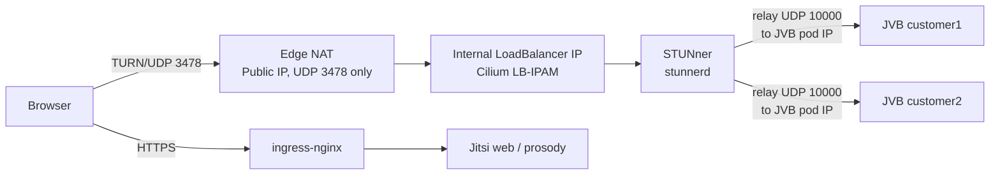

# Jitsi Meet on Kubernetes with STUNner — Single Public IP

Run one or many [Jitsi Meet](https://jitsi.org/) instances on Kubernetes and carry **all** of their voice/video traffic through a single public IP and a single UDP port, using [STUNner](https://github.com/l7mp/stunner) as an in-cluster TURN gateway.

No `hostNetwork`, no `NodePort` ranges, no public IP per JVB.

---

## Why

Jitsi Videobridge (JVB) normally needs a publicly reachable UDP port per bridge. On Kubernetes that usually means `hostNetwork`, NodePorts, or one LoadBalancer IP per JVB — painful when you only have one public IP or when you host many Jitsi instances (e.g. one per customer).

With STUNner:

- Browsers connect to **one TURN endpoint** (`<PUBLIC_IP>:3478/udp`).
- STUNner relays media to the JVB **pod IP** inside the cluster.
- Every additional Jitsi instance is just one more `UDPRoute`.

## Architecture



Only the STUNner LoadBalancer Service is NATed from the public IP. The LoadBalancer IP itself is an **internal** address assigned by Cilium LB-IPAM; JVBs stay on plain `ClusterIP` Services and are never exposed directly.

How it works:

1. The browser loads Jitsi over HTTPS (ingress) and joins a room.
2. Prosody hands the browser short-lived TURN credentials (XEP-0215, `external_services`) pointing to `<PUBLIC_IP>:3478`.
3. JVB advertises only its **pod IP** (`10.x.x.x:10000`) as an ICE candidate.
4. The browser allocates a relay on STUNner and sends media to the JVB pod IP through it.
5. STUNner only allows relaying to IPs that belong to a backend Service of an attached `UDPRoute` — so each JVB Service must be routed.

## Prerequisites

Tested with:

| Component | Version | Notes |
|---|---|---|
| Kubernetes | — | Bare-metal cluster |
| Cilium | `1.19.0` | CNI **and** LoadBalancer (LB-IPAM + L2 announcements) — no MetalLB |
| ingress-nginx | chart `4.13.2` | For Jitsi web (HTTPS) |
| cert-manager | `v1.20.2` | TLS certificates for Jitsi web |
| Helm | 3 | |
| STUNner | `1.1.0` | Gateway operator + stunnerd + auth service |
| Jitsi Helm chart | `jitsi-meet` chart `3.0.2` | [`jitsi-contrib/jitsi-helm`](https://github.com/jitsi-contrib/jitsi-helm), images `stable-11146-1` |

Edge firewall / router:

- `UDP 3478` on `<PUBLIC_IP>` → NAT to the STUNner LoadBalancer IP `<LB_INTERNAL_IP>`. This is the **only** media path from the internet.
- Jitsi web is published through your ingress controller as usual (HTTPS). Media never goes through the ingress.

## Repository layout

```
.
├── README.md
├── LICENSE
├── cilium/
│   └── lb-ipam.yaml               # LoadBalancer IP pool + L2 announcement for STUNner
├── stunner/
│   ├── values-stunner.yaml        # STUNner operator Helm values
│   ├── gatewayconfig.yaml
│   ├── gateway.yaml
│   └── udproute-template.yaml     # UDPRoute + ReferenceGrant per Jitsi instance
├── jitsi/
│   ├── values.yaml                # minimal Jitsi values
│   └── turn-secret.example.yaml   # Secret holding TURN_CREDENTIALS
├── network-policies/
│   └── cilium-policies.yaml       # optional
├── debug/
│   ├── stun-ping.py               # does UDP reach STUNner?
│   ├── gen-turn-credentials.sh    # temporary TURN credentials
│   └── udp-echo.yaml              # end-to-end TURN test without Jitsi
└── docs/
    └── troubleshooting.md
```

Placeholders used throughout:

| Placeholder | Meaning |
|---|---|
| `<PUBLIC_IP>` | Your public IP, NATed to STUNner |
| `<LB_INTERNAL_IP>` | LoadBalancer IP assigned to the STUNner Gateway |
| `<TURN_SHARED_SECRET>` | Shared secret between STUNner and Prosody |
| `jitsi.example.com` | Jitsi hostname |

---

## 0. Internal LoadBalancer IP with Cilium LB-IPAM

STUNner's Gateway is exposed as a `LoadBalancer` Service. Cilium assigns it an internal IP from a pool and announces it on the LAN (L2), so the edge router can NAT the public IP to it.

Requires Cilium installed with `l2announcements.enabled=true` (and `kubeProxyReplacement=true`, which L2 announcements depend on).

`cilium/lb-ipam.yaml`:

```yaml
apiVersion: cilium.io/v2
kind: CiliumLoadBalancerIPPool
metadata:
  name: stunner-pool
spec:
  blocks:
    - start: "<LB_INTERNAL_IP>"
      stop: "<LB_INTERNAL_IP>"
  serviceSelector:
    matchLabels:
      io.kubernetes.service.namespace: stunner
---
apiVersion: cilium.io/v2alpha1
kind: CiliumL2AnnouncementPolicy
metadata:
  name: stunner-l2
spec:
  serviceSelector:
    matchLabels:
      io.kubernetes.service.namespace: stunner
  loadBalancerIPs: true
  interfaces:
    - ^eth[0-9]+          # adjust to your node interface names
```

```bash
kubectl apply -f cilium/lb-ipam.yaml
```

> API versions differ between Cilium releases. On Cilium 1.19 check with `kubectl api-resources | grep -i cilium` and adjust `apiVersion` if needed. If you announce LoadBalancer IPs via BGP instead of L2, keep the pool and use your BGP advertisement.

The Gateway in step 2 pins its IP with the `io.cilium/lb-ipam-ips` annotation.

## 1. Install STUNner

```bash
helm repo add stunner https://l7mp.io/stunner
helm repo update
helm install stunner stunner/stunner-gateway-operator \
  --version 1.1.0 \
  -n stunner-system --create-namespace \
  -f stunner/values-stunner.yaml
```

`values-stunner.yaml` deliberately runs the operator **without** `--leader-elect`. With a single replica it adds nothing, and a slow kube-apiserver makes the operator exit ("leader election lost"), which drops stunnerd's config watch. See [docs/troubleshooting.md](docs/troubleshooting.md#5-stale-stunnerd-config).

STUNner ends up in two namespaces — this is expected:

| Namespace | Role | Pods |
|---|---|---|
| `stunner-system` | Control plane (installed by Helm) | Gateway operator (watches Gateway API objects, serves config via CDS on `:13478`), auth service |
| `stunner` | Data plane (created by the operator) | `stunner-gateway` — the stunnerd pods that relay TURN traffic, created in the Gateway's namespace |

## 2. Create the Gateway

`stunner/gatewayconfig.yaml` — long-term (ephemeral) TURN auth, compatible with Prosody's TURN credentials:

```yaml
apiVersion: stunner.l7mp.io/v1
kind: GatewayConfig
metadata:
  name: stunner-gatewayconfig
  namespace: stunner
spec:
  realm: stunner.l7mp.io
  authType: longterm
  sharedSecret: "<TURN_SHARED_SECRET>"
```

`stunner/gateway.yaml` — one TURN-UDP listener on 3478:

```yaml
apiVersion: gateway.networking.k8s.io/v1
kind: Gateway
metadata:
  name: stunner-gateway
  namespace: stunner
  annotations:
    stunner.l7mp.io/gateway-config-name: stunner-gatewayconfig
    io.cilium/lb-ipam-ips: "<LB_INTERNAL_IP>"   # pin the LB IP (Cilium LB-IPAM)
spec:
  gatewayClassName: stunner
  listeners:
    - name: udp-listener
      port: 3478
      protocol: TURN-UDP
```

```bash
kubectl create namespace stunner
kubectl apply -f stunner/gatewayconfig.yaml -f stunner/gateway.yaml
kubectl -n stunner get gateway,svc
```

The Gateway should be `PROGRAMMED=True` and its LoadBalancer Service should have `EXTERNAL-IP=<LB_INTERNAL_IP>`.

## 3. Deploy Jitsi

Store the TURN secret in a Kubernetes Secret instead of plain Helm values:

```bash
kubectl create namespace jitsi
kubectl -n jitsi create secret generic jitsi-turn \
  --from-literal=TURN_CREDENTIALS='<TURN_SHARED_SECRET>'
```

(Or copy `jitsi/turn-secret.example.yaml` to `turn-secret.local.yaml`, fill it in and apply it. `*.local.yaml` is git-ignored.)

`jitsi/values.yaml` (only the parts that matter — keep everything else at chart defaults):

```yaml
publicURL: "https://jitsi.example.com"

web:
  custom:
    configs:
      _custom_config_js: |
        config.useTurnUdp = true;      // REQUIRED: Jitsi drops TURN/UDP for JVB by default
        config.p2p = { enabled: false };
  ingress:
    enabled: true
    ingressClassName: nginx
    annotations:
      cert-manager.io/cluster-issuer: "letsencrypt"
    hosts:
      - host: jitsi.example.com
        paths: ["/"]
    tls:
      - secretName: jitsi-example-tls
        hosts: [jitsi.example.com]

prosody:
  extraEnvs:
    TURN_HOST: "<PUBLIC_IP>"
    TURN_PORT: "3478"
    TURN_TRANSPORT: "udp"
  extraEnvFrom:
    - secretRef:
        name: jitsi-turn           # provides TURN_CREDENTIALS

jicofo:
  resources:
    requests: { cpu: 100m, memory: 512Mi }
    limits:   { cpu: 500m, memory: 768Mi }
  extraEnvs:
    JICOFO_MAX_MEMORY: "512m"

jvb:
  useNodeIP: false
  disableStun: true                # JVB must advertise its pod IP only
  useHostPort: false
  useHostNetwork: false
  UDPPort: 10000
  service:
    type: ClusterIP
  resources:
    requests: { cpu: 500m, memory: 1Gi }
    limits:   { cpu: 2,    memory: 1536Mi }
  extraEnvs:
    VIDEOBRIDGE_MAX_MEMORY: "1024m"
```

```bash
helm repo add jitsi https://jitsi-contrib.github.io/jitsi-helm/
helm repo update
helm upgrade --install jitsi-customer1 jitsi/jitsi-meet --version 3.0.2 -n jitsi -f jitsi/values.yaml
```

> Do **not** set `JVB_ADVERTISE_IPS`. If JVB advertises a public or node IP, STUNner will refuse to relay to it.

## 4. Route STUNner to the JVB

`stunner/udproute-template.yaml` — one `UDPRoute` per Jitsi instance, plus a `ReferenceGrant` in the Jitsi namespace:

```yaml
apiVersion: gateway.networking.k8s.io/v1alpha2
kind: UDPRoute
metadata:
  name: jitsi-customer1-jvb-route
  namespace: stunner
spec:
  parentRefs:
    - name: stunner-gateway
      namespace: stunner
  rules:
    - backendRefs:
        - name: jitsi-customer1-jitsi-meet-jvb
          namespace: jitsi
          port: 10000
---
apiVersion: gateway.networking.k8s.io/v1beta1
kind: ReferenceGrant
metadata:
  name: allow-stunner-to-jitsi
  namespace: jitsi
spec:
  from:
    - group: gateway.networking.k8s.io
      kind: UDPRoute
      namespace: stunner
  to:
    - group: ""
      kind: Service                 # no name = all Services in this namespace
```

```bash
kubectl apply -f stunner/udproute-template.yaml
```

## 5. Verify

**Route status** — both conditions must be `True`:

```bash
kubectl -n stunner get udproute jitsi-customer1-jvb-route -o yaml | sed -n '/status:/,$p'
```

**stunnerd has the JVB pod IP** in its active configuration:

```bash
kubectl -n jitsi get pod -l app.kubernetes.io/component=jvb -o wide
kubectl -n stunner logs deploy/stunner-gateway | grep "New configuration" | tail -1
```

The JVB pod IP must appear in `endpoints=[...]` of the route's cluster.

**UDP reaches STUNner** — from a machine outside your network (no credentials needed):

```bash
python3 debug/stun-ping.py <PUBLIC_IP>
```

**TURN from the internet** — generate temporary credentials:

```bash
./debug/gen-turn-credentials.sh '<TURN_SHARED_SECRET>' <PUBLIC_IP>
```

Open the [Trickle ICE test page](https://webrtc.github.io/samples/src/content/peerconnection/trickle-ice/) from a device **outside** your network (e.g. mobile data), add `turn:<PUBLIC_IP>:3478?transport=udp` with those credentials, and click *Gather candidates*. A `relay` candidate means NAT, LoadBalancer, STUNner and auth all work.

**Full TURN path without Jitsi** — `debug/udp-echo.yaml` deploys a UDP echo pod behind its own `UDPRoute`:

```bash
kubectl apply -f debug/udp-echo.yaml
kubectl -n stunner get pod udp-echo -o jsonpath='{.status.podIP}{"\n"}'

# from a machine on the internet (turncat ships with STUNner):
turncat --log=all:INFO - "<turncat URI from gen-turn-credentials.sh>" udp://<POD_IP>:9001
# type a line + Enter -> it must come back

kubectl delete -f debug/udp-echo.yaml
```

**In a real Jitsi call** — open `chrome://webrtc-internals` in another tab, join a room, and check that `iceServers` contains your TURN URL and the selected candidate pair is `relay` → `<JVB_POD_IP>:10000`.

---

## Multiple Jitsi instances (multi-tenant)

All instances share the **same** Gateway, listener, public IP and TURN secret. STUNner allows relaying to the endpoints of **every** route attached to the listener, and each browser only ever sends to the JVB its own Jitsi told it about.

For each new instance:

1. Deploy Jitsi with its own `publicURL`, ingress host and TLS secret name. TURN settings stay identical.
2. Add a `UDPRoute` pointing to its JVB Service (all JVBs can use port `10000` — each has its own pod IP).
3. Add a `ReferenceGrant` if the instance lives in a new namespace.
4. Verify that its JVB pod IP shows up in the stunnerd configuration.

**Isolation note:** with a shared secret, an authenticated TURN client of one tenant could send packets to another tenant's JVB port. JVB's ICE and DTLS-SRTP prevent media injection or eavesdropping, so this is acceptable for most setups. For strict isolation, use a separate Gateway + GatewayConfig (own secret) per tenant on a different port.

## Network policies (Cilium)

If you run default-deny policies, make sure to allow:

- UDP `10000` into JVB pods from STUNner (`stunner` namespace) — or from `all` if you prefer
- TCP `13478` from stunnerd pods (`stunner` namespace) to the STUNner operator (config discovery) in `stunner-system`
- Ingress controller namespace → Jitsi web pods **and** cert-manager HTTP-01 solver pods

An example is in `network-policies/cilium-policies.yaml`. Prefer namespace **labels** over hard-coded namespace lists so new tenants are covered automatically.

---

## Troubleshooting

Lessons learned while building this setup. More detail in `docs/troubleshooting.md`.

| Symptom | Cause | Fix |
|---|---|---|
| Room opens, no audio/video, disconnects after a few seconds | ICE to JVB fails | Work through the rows below |
| Browser never uses TURN | Jitsi filters TURN/UDP for the JVB connection by default | `config.useTurnUdp = true;` |
| `iceServers` empty in the browser | Wrong Prosody env names (`TURN_CREDENTIALS_SECRET`, `TURNS_HOSTS`, …). `TURNS_*` means TURN over **TLS** | Use `TURN_HOST`, `TURN_PORT`, `TURN_TRANSPORT=udp`, `TURN_CREDENTIALS` |
| stunnerd log: `permission denied ... to peer <ip>: no route to endpoint` | The peer IP is not in any routed backend | Check `UDPRoute` status, `ReferenceGrant`, and that JVB is not advertising another IP |
| Same error although the route is correct | stunnerd lost its watch on the config discovery service and kept a **stale** config (old JVB pod IP) | Compare the operator's CDS config with stunnerd's last `New configuration` log; restart stunnerd. Alert on `closing connection` without a reconnect |
| stunnerd repeatedly logs CDS `i/o timeout`, `abnormal closure`, `connection refused` | The gateway operator keeps restarting; every restart drops stunnerd's config watch | Check operator restarts (`kubectl -n stunner-system get pods`) and `logs --previous`: raise its memory limit if OOMKilled, investigate apiserver latency if leader election is lost |
| JVB / jicofo in `CrashLoopBackOff`, liveness `connection refused` | Both are Java apps; 100m CPU / 128Mi is far too little (slow JVM start, OOM) | Give them real CPU/memory and set `*_MAX_MEMORY` below the memory limit |
| Helm: `nil pointer evaluating interface {}._default` | An empty key in values (e.g. `defaults:`) is `null`, which **deletes** the chart default | Remove empty keys entirely |
| cert-manager: `failed to perform self check GET request ... context deadline exceeded` | Hairpin NAT missing, port 80 not forwarded, or a network policy blocking the ingress controller → solver pod | Test from inside and outside the cluster; fix NAT / policy, or use DNS-01 |

Useful commands:

```bash
# Prosody TURN config
kubectl -n jitsi exec <prosody-pod> -- env | grep TURN

# Config the operator serves to stunnerd
kubectl -n stunner-system port-forward svc/stunner-config-discovery 13478:13478 &
curl -s localhost:13478/api/v1/configs | python3 -m json.tool

# Verbose STUNner logs
kubectl -n stunner patch gatewayconfig stunner-gatewayconfig --type=merge \
  -p '{"spec":{"logLevel":"all:DEBUG"}}'
kubectl -n stunner logs -f deploy/stunner-gateway
```

## Security notes

- Never commit real secrets. Keep the TURN secret in a Kubernetes Secret (or an external secret manager).
- Rotate the TURN secret in **both** the `GatewayConfig` and every Prosody instance at the same time.
- Restrict the edge firewall to exactly `UDP 3478` for STUNner.

## License

MIT
